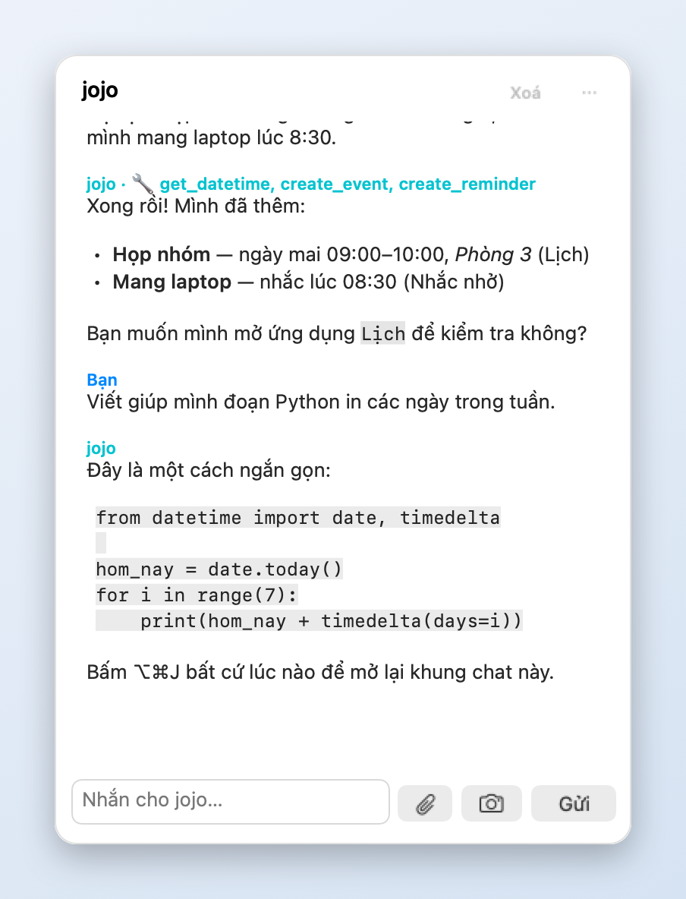
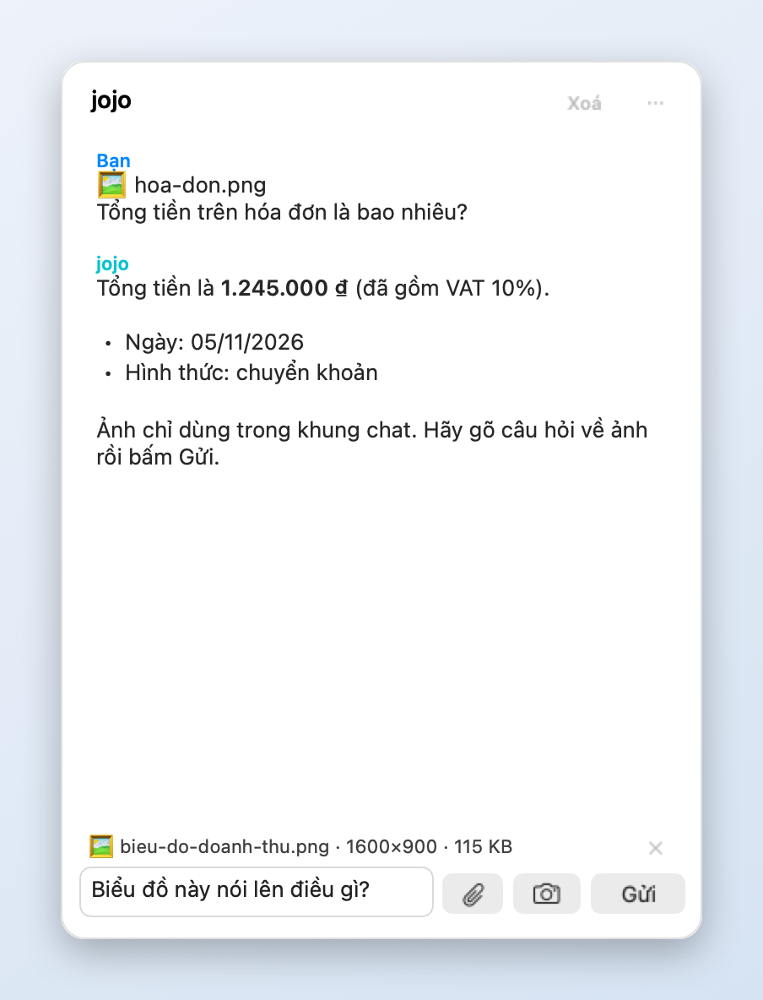
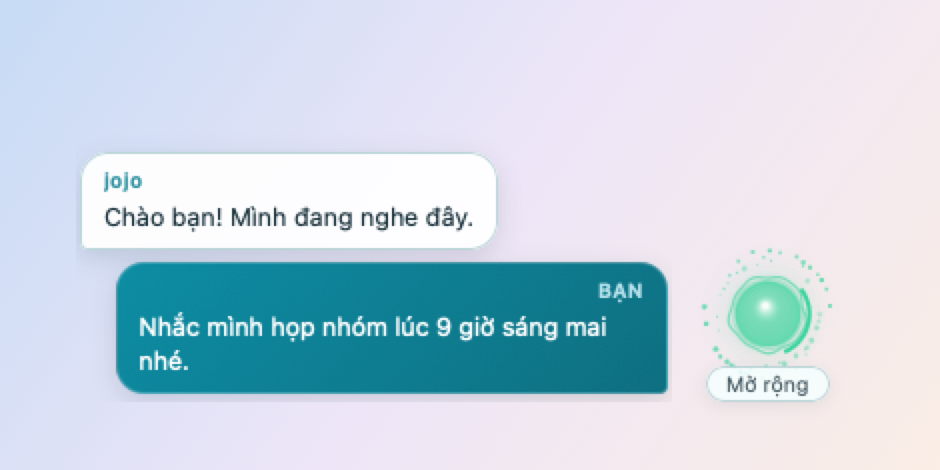
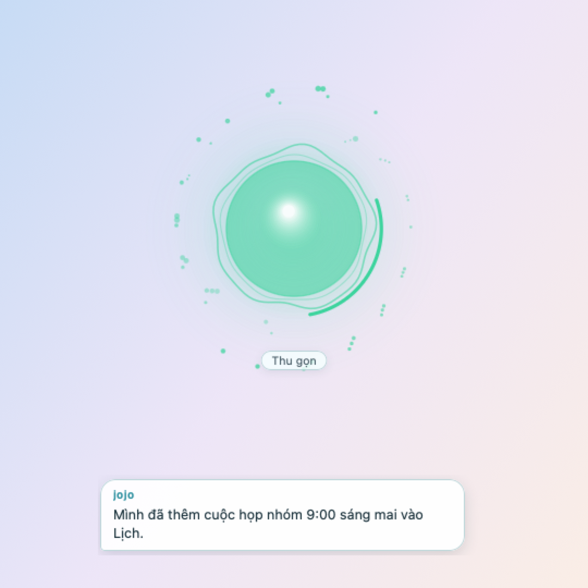
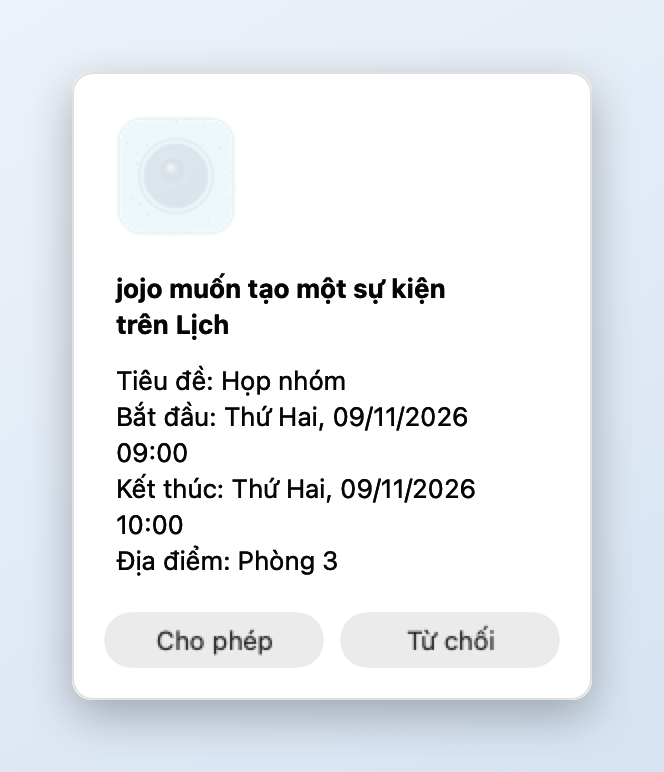

# Jojo — Your Personal AI Agent from AitechAsia

**JojoAgent** is a personal AI assistant from **AitechAsia** that lives on your desktop. Talk to it hands-free in a live voice call, chat with it in text, and let it look at your screen to help with what you are working on.

| Platform | Status | Download |
| :--- | :--- | :--- |
| **macOS** 12+ (Apple Silicon and Intel) | Stable, `v2.4.0` | [Latest release](https://github.com/ethando1984/JojoAgent/releases/latest) |
| **Windows** 10 / 11 (64-bit) | **Preview** | [Windows preview release](https://github.com/ethando1984/JojoAgent/releases/tag/v2.4.0-windows-preview) |

## ✨ What's new in v2.4.0: JoJo Guardian, child protection
For a child's computer: a parent sets the rules on the Hub, and JojoAgent enforces them on the computer, **even offline**. The app looks the same as before: there is no new window, and notices come as system notifications (Windows: tray balloons) and in jojo's own answers.
- **Screen time.** Only the time an app is in front and in use counts (no keyboard or mouse for 2 minutes stops the count, unless a video is playing). You can set a daily total, a bedtime, a "rest your eyes" reminder and per-app limits; 0 minutes blocks an app. The child gets a notice 5 and 1 minutes before the time runs out. When it runs out mid-use, the app stays open one more minute so the child can save, then it is asked to close (it can still ask to save) and is hidden if it stays in front. Settings, accessibility tools, Finder / Explorer and JojoAgent always stay usable, and so do the apps the parent always allows (for example a calling app).
- **A safer assistant (child mode).** jojo talks for the child's age. It has no file, clipboard, screen or computer-control tools. It refuses sites the parent denies, or anything outside the allowed list. It does not open an app whose time is up. When the child is in trouble it points them to a trusted adult and to the 111 child helpline. The child can ask jojo *"how many minutes are left?"* or ask for more time; the request appears on the Hub for the parent to approve.
- **Rules nobody else can change.** The Hub signs the rules, and every change needs the parent's **guardian PIN**. The app refuses a copy that was edited by hand, a copy made for another computer, an older version, and rules from another account signed in on the same computer. If someone tampers with the rules, changes the clock, or stops or starts JojoAgent, the Hub shows it to the parent.
- **What is reported:** the app names and minutes per day, and the events above. A blocked site is reported by its domain only. Nothing is sent about window titles, page contents, messages or screenshots, and usage is only reported while protection is on (kept 30 days). Every JojoAgent now also reports its computer name, system and version to your account once an hour, so the computer shows up on the Hub's *Bảo vệ trẻ em* page.
- **Not yet:** the browser itself is not filtered (a browser extension is next), and protection runs only while JojoAgent runs (quitting it shows on the Hub). Give the child a standard (non-administrator) account.

> Needs the current jojo server. Set it up on the Hub: **Tools › Bảo vệ trẻ em** (see *How to use it › 6* below).

### v2.3.1
- **Reconnects by itself.** If you signed in again after your old session had expired, the Hub could still hold the key of this computer while the app had forgotten it: pairing was refused, remote control switched itself off ("máy đã có khoá trên Hub") and asked for your consent again every time. The app now revokes that stale key with your sign-in and pairs again, once per start, without you doing anything.
- **Consent is asked once per account.** Switching remote control off and on again no longer asks again. It asks again after **Esc**, after **Ngắt máy này** from the Hub, when the key was revoked, after signing out, or for another account.
- **Waits instead of failing at 30 actions a minute.** An action that finds the minute full waits (up to 30 s) for room instead of being refused; Esc during the wait stops it.
- **Windows with no accessibility tree.** A window that does not expose one (some Electron apps, games, canvases) is now described from its picture instead of just returning an error.
- **`desktop_action` can verify itself.** With `expect` the answer says in the same call whether the change you wanted was seen (`verified: true / false`).
- **Dialogs that block are named.** When a sheet, alert or menu opens after an action, the result says so and how to answer it.
- **Windows:** a tool error now says where it came from, which helps find the rare "JsonSerializerOptions" failure.
- With the current Hub: per-app hints for the model (administrators edit them), the model is stopped when it repeats itself, and *My computers* shows the rules that applied and how well control goes.

### v2.3.0
- **`desktop_inspect`: diagnose one window exactly.** Until now the model had two separate ways to look at a window: the accessibility tree (exact text and controls, but blind to what is only drawn) and a screenshot of the whole screen (sees everything, but reads small text by guessing). The new tool reads the window's tree **and** takes a picture of that same window, then a vision model compares the two and tells you what state the window is in (page, dialog, error, still loading, asking you to sign in), what only the picture shows (images, charts, colours), where picture and tree disagree, and what to do next. The full tree, with refs the model can act on, comes back too; if the picture cannot be taken the tree still comes back. The model is told to use it when a plain snapshot is empty or confusing, since it costs one extra vision call. Available in chat and from the Hub (not in voice calls), on macOS and Windows (on Windows, when the window picture cannot be taken, the whole screen is used and the model is told).
- **Rules from the Hub now cover this computer.** With the current Hub, what it may do on your computer is governed by *Guardrails & Validators*: first the rules your administrator set (they hold for everyone), then your own, which can add to them but never lift them. A rule can limit tools, apps and web sites, and the usual content rules also check what you type, what the screen shows and what the model answers. A refused command never reaches your computer and shows as **Blocked** on the *My computers* page. If the rules cannot be checked, nothing is sent.

> The Hub-side rules need the current jojo server (nothing changes in how the app asks for consent, shows 🔴 or stops with `Esc`).

### v2.2.0
- **Control this computer from the Hub chat (optional, off by default).** In the Hub's Playground (MCP mode) you can pick this computer and ask for something ("check my email", "open Facebook and look up …"): jojo opens the app or page, reads it through its accessibility tree, acts, checks the result and keeps going until the goal is done. Switch it on in the menu: **◉ › Điều khiển từ Hub** (Windows: tray icon). The app asks for your consent **once, when you switch it on**; after that, commands from the Hub run **without an Allow dialog**, because nobody may be at the computer to click.
- **You can always see it, and stop it.** While the Hub is operating your computer, ◉ turns into 🔴 (Windows: the tray tooltip says so and one balloon tip appears), until five minutes after the last command. **Press `Esc` to stop at once; that also switches the feature off.** You can also press **Ngắt máy này** on the Hub's *My computers* page to cut a computer off from afar.
- **Each computer has its own key.** When you switch the feature on, the app asks once for a key of its own (kept in the macOS Keychain; on Windows, encrypted with DPAPI) and uses only that key to receive commands. Your sign-in can then no longer pose as the computer, and you can revoke the key on the Hub. Everything the Hub sends is logged (which tool, a short summary, the result, the address it came from; **text typed into the computer is never stored**, only its length) and you can read it on the *My computers* page.
- **Screen captures also read the window's text** through the accessibility tree, so small text, numbers, error codes and code are read exactly instead of guessed from the picture.
- **Esc is reliable:** it works for every command from the Hub (including opening an app or a page), and stops having any effect once the session is over.

> **Anyone holding your Hub sign-in can send commands to a computer while the feature is on.** Keep it off when you do not use it, check the log on the *My computers* page, and press **Ngắt máy này** or `Esc` if you see something you did not do. The feature needs the current jojo server; with an older one the app falls back to its sign-in, as before.

Earlier: **v2.1.0** added operating apps through their accessibility tree (`desktop_snapshot`, `desktop_find`, `desktop_action`, `desktop_list_apps`, built on the bundled [agent-desktop](https://github.com/ethando1984/agent-desktop), Apache-2.0); **v2.0.0** added answers from your Knowledge Base and the web.

---

## 🖼️ Screenshots

> The images below are rendered from the real macOS app; the conversation text, file names and figures are **examples only**. The app's own interface is in Vietnamese.

**Chat from the menu bar:** replies stream in as they are written, with Markdown (lists, code blocks, links) and a 🔧 label for the tools jojo used. Left-click ◉ or press `⌥⌘J` to open it.

**Attach an image or file, or capture the screen:** the 📎 button picks a text file, a PDF or an image; the camera button captures the screen and asks jojo about it.

**Voice call, compact mode:** a small **jojo** orb in the corner of the screen with live subtitles; drag it to move it, click **Mở rộng** (Expand) to enlarge.

**Voice call, full mode:** a large audio-reactive orb that follows the voice in real time (its colour changes with listening / thinking / speaking); click **Thu gọn** (Collapse) to go back.

**Always asks before doing anything with an effect:** adding a calendar event or a reminder, opening an app, reading or writing a file all show an *Allow / Deny* dialog with the real details (the default button is *Deny*).

**Sign-in and invites:** the password is sent once, and the token is kept in the macOS Keychain (on Windows, encrypted with DPAPI). No account yet? The sign-in window has a **"Chưa có tài khoản? Xin lời mời →"** link to the invite page on the Hub: enter your email, and an administrator reviews the request, creates your account and sends you the sign-in details.

---

## 📦 Install on macOS

**Requirements:** macOS 12.0 or later (Apple Silicon `M1/M2/M3/M4` and Intel).

### Option 1: the `.dmg` installer (recommended)
1. Download **`JojoAgent-macos-universal-v2.4.0.dmg`** from [**Releases**](https://github.com/ethando1984/JojoAgent/releases/latest) (or take **`JojoAgent.dmg`** straight from this repository).
2. Double-click the `.dmg`, then drag **`JojoAgent.app`** onto the **`Applications`** folder.
3. Open **`JojoAgent`** from **Applications** or **Launchpad**. If macOS asks you to confirm the first launch, choose **Open** (or run `xattr -cr /Applications/JojoAgent.app` in Terminal).

### Option 2: the `.zip` or the `.app` directly
1. Download **`JojoAgent-macos-universal-v2.4.0.zip`** from [**Releases**](https://github.com/ethando1984/JojoAgent/releases/latest) and unzip it (or take the **`JojoAgent.app`** folder from this repository).
2. Drag **`JojoAgent.app`** into **`/Applications`** and open it.

---

## 🪟 Install on Windows (preview)

> **This is a preview.** The Windows version is new and has had no testing on real PCs yet, so expect rough edges. It is not code-signed. Please report what you find in [Issues](https://github.com/ethando1984/JojoAgent/issues).

**Requirements:** Windows 10 (version 2004 or later) or Windows 11, 64-bit (x64). A microphone for voice calls.

### Option 1: the installer (recommended)
1. Download **`JojoAgent-windows-x64-v2.4.0-preview-Setup.exe`** from the [**Windows preview release**](https://github.com/ethando1984/JojoAgent/releases/tag/v2.4.0-windows-preview).
2. Run it. Because the preview is not code-signed, Windows SmartScreen shows a warning: choose **More info → Run anyway**.
3. Follow the installer. It installs for your Windows account only (no administrator prompt), adds a Start menu shortcut, and installs Microsoft Edge WebView2 Runtime if your PC does not have it.
4. JojoAgent starts with an icon in the system tray (near the clock) and the **jojo** orb at the bottom-right of the screen.

To remove it: **Settings → Apps → Installed apps → JojoAgent → Uninstall**.

### Option 2: portable `.zip`
Download **`JojoAgent-windows-x64-v2.4.0-preview.zip`**, unzip it anywhere and run **`JojoAgent.exe`**. This needs Microsoft Edge WebView2 Runtime, which Windows 11 and most Windows 10 PCs already have.

### What is different on Windows
- **Tray icon instead of the menu bar:** left-click the tray icon to open the chat, right-click it for the menu. The global shortcut is **`Ctrl+Alt+J`**.
- **Sign-in storage:** the token is encrypted with Windows DPAPI for your Windows account (`%APPDATA%\JojoAgent`), and is never given to the app's web page.
- **Calendar and reminders** use classic Outlook when it is installed. Without it, creating an event or reminder opens an `.ics` file in your calendar app for you to save, and listing events or reminders is not available.
- **Mouse and keyboard control** and **operating apps** (`desktop_*`) need no extra permission, but cannot act on windows that run as administrator. For `desktop_*`, `app` is the process name (`notepad`, `msedge`, …).
- **Image attachments:** PNG, JPEG, GIF, BMP and TIFF (HEIC is not supported).
- If something goes wrong, errors are written to `%LOCALAPPDATA%\JojoAgent\jojo.log`.

---

## 🚀 How to use it

The steps below describe the macOS app. On Windows the same features are reached from the tray icon, with the shortcut differences listed above.

### 0. Text chat from the menu bar
**Left-click** the **◉** icon (or press **`⌥⌘J`** from any app) to open the chat with jojo. **Right-click** ◉ (or the **⋯** button) for the three-row menu: *Start / End call*, *Account…*, *Quit jojo*.

- **Streaming replies + Markdown:** text appears as soon as the server sends it; **bold**, *italic*, `code`, code blocks, headings, lists, quotes and links are supported (links only to `http(s)` / `mailto`, and the real address always shows on hover).
- **📎 Attach:** a text file / PDF (≤ 2 MB, the first 20,000 characters are read) or an **image** (≤ 15 MB, downscaled automatically; an image too large for your plan is retried once in a compact version). A file is also handed to the voice call (immediately if a call is live, otherwise when one starts); images are used in chat only.
- **Camera:** captures the screen and asks jojo about it (using what you typed in the input box, if anything). The first time, macOS asks for the Screen Recording permission.
- **Chat history is kept between launches** (the last 40 messages, stored locally, without the contents of attached files or images). **Xoá** (Clear) or signing out deletes it; turn it off entirely with `defaults write asia.aitech.jojo.agent jojo_save_history -bool false`.

**Jojo can call tools** when you ask (the chat shows *“Đang dùng công cụ: …”* (Using tool: …) and a 🔧 label):
- *Runs by itself (read-only):* capture and analyse the screen, get the date and time, read the clipboard, see which app you were using, get system information.
- *Always asks you first (Allow / Deny):* open a web page, open an app, read a text file (only in Desktop / Documents / Downloads), create or overwrite a file (only in `~/Documents/JojoAgent`), add a calendar event, add a reminder, list the next 7 days of your calendar, list unfinished reminders.
- *Operate apps (same session as the mouse and keyboard):* `desktop_list_apps`, `desktop_snapshot` (read an app's interface; big apps first as an outline), `desktop_find` (find a button, field or menu item by name), `desktop_action` (click, type, set a value, select an option, check / uncheck, expand, scroll… on one control). jojo prefers these and verifies each step with a fresh snapshot. What it reads from an app is sent to the jojo server as part of the conversation and treated as data, never as instructions. On macOS this uses the same **Accessibility** permission (if System Settings also lists `agent-desktop`, turn it on too). On Windows it cannot act on windows that run as administrator, and a minimized window cannot be read.
- *Mouse and keyboard control (one Allow opens a 5-minute session):* `click_on_screen`, `type_text`, `press_key`, `scroll_screen`. jojo looks at a fresh screenshot to find what to click, never types into password fields, and is limited to 30 actions per minute. **Press `Esc` at any time to stop.** On macOS this needs JojoAgent enabled under **System Settings › Privacy & Security › Accessibility**; on Windows it cannot act on windows that run as administrator.
- **During a voice call** jojo can also use the calendar, reminders, open apps / web pages and get the date and time, through the same Allow / Deny dialog (you approve with a click). With the gpt-live model this needs an up-to-date gateway server.

### 1. Sign in / first-time setup
1. When the app opens, the **JojoAgent** **◉** icon appears in the menu bar (top right of the screen) and the **jojo** orb at the bottom of the screen.
2. **Right-click** the **◉** icon (or press **`⌘,`**) and choose **Tài khoản…** (Account…).
3. Enter your **AitechAsia** **username and password** (or a **token / API key**), then confirm.
4. No account yet? Click **Chưa có tài khoản? Xin lời mời →** in the same window. It opens the Hub's invite page; enter your email and wait for an administrator to approve it. You then receive your username, password and API token (by email when the Hub has email set up).

### 2. Talk by voice
- **Start / end a call:** click the **jojo** orb on the screen, or press **`⌘R`**.
- The first time, macOS asks for access to the **Microphone** — choose **Allow** to talk to jojo.
- During a call the window stays in **compact** mode with floating subtitles, so you can talk and keep working. Scroll the subtitles up and down to review the conversation.

### 3. Move the orb and switch display mode
- **Move:** press and hold on the **jojo** orb and drag it anywhere on the screen (in both compact and full mode).
- **Expand / collapse:** click the **Mở rộng / Thu gọn** button under the orb.

### 4. Ask jojo to look at and explain what is on the screen
- **By voice:** during a call, just say it naturally, for example:
  - *"Jojo, take a screenshot and tell me what this error is"*
  - *"What is on my screen right now?"*
  - *"Explain what is on the screen for me"*
- **By button:** click the **📸** icon next to the orb (or the **📸 Chụp màn hình** (Capture screen) button in full mode).
- *Note:* the first capture makes macOS ask for the **Screen Recording** permission; JojoAgent opens **System Settings → Privacy & Security → Screen & System Audio Recording** for you. Turn on **JojoAgent**, then **quit and reopen the app** for the permission to take effect. If it is on and capture still fails, run `tccutil reset ScreenCapture asia.aitech.jojo.agent` and grant it again.

### 5. Let the Hub operate this computer (optional)
1. Sign in (step 1), then right-click **◉** (Windows: the tray icon) and choose **Điều khiển từ Hub**. Read the confirmation and agree: it is the one consent for everything the Hub sends later. It is off by default and the choice is remembered.
2. On the Hub (`https://hub.aitech.asia/playground/`) choose **MCP** mode, then pick this computer in **Máy tính:** (only your own computers that have the feature on are listed).
3. Ask for what you want. jojo keeps going until it is done, in at most 40 tool steps per message. The model is instructed to stop and ask before sending, posting, deleting, buying or paying, but nothing on your computer enforces that, so word your requests carefully. The app itself never types into password fields, never touches its own windows or the system's sign-in prompts, and does at most 30 actions a minute.
4. While it works, ◉ shows 🔴. **Press `Esc`** to stop and switch the feature off; switch it back on in the menu when you want it again.
5. The Hub's **My computers** page (Tools menu) lists your computers, every command with its result, time and address (grouped by request), and has **Ngắt máy này** (cut a computer off) and **Thu hồi khoá** (revoke its key).

### 6. Protect a child's computer (JoJo Guardian, optional)
1. Install JojoAgent on the child's computer and sign it in (preferably with the child's own Hub account). Start it once: within a minute the computer appears on the Hub under **Tools › Bảo vệ trẻ em**.
2. On that page choose **Quản lý** (Manage) for the computer. Set the child's name and age, the daily minutes, bedtime, app limits (one app per line: its name as shown, its macOS bundle id or its Windows process name; the page lists the apps seen on the computer), always-allowed apps, denied or allowed web sites and child mode. Choose a **guardian PIN** the first time and save. The computer applies the rules within 5 minutes and keeps them offline.
3. The **Thời gian dùng** (Usage) tab shows the last 7 days. The **Sự kiện** (Events) tab shows apps closed, sites and tools refused, and requests for more time, which you can approve with your PIN (**Cho N phút**) or set aside.
4. To lift everything, switch **Bảo vệ máy này** off and save with the PIN. Signing JojoAgent in with another account does not lift it.

---

## ⌨️ Keyboard shortcuts

| macOS | Windows (preview) | Action |
| :--- | :--- | :--- |
| **`⌥⌘J`** | **`Ctrl+Alt+J`** | Open / close the chat (from any app) |
| **`⌘R`** | Tray menu | Start / end the voice call |
| **`⌘,`** | Tray menu | Open the Account window |
| **`⌘Q`** | Tray menu | Quit JojoAgent |

---

## 🔒 Security and performance
- The token / API key is stored in the **macOS Keychain** (on Windows: encrypted with DPAPI), never as plain text, and is never handed to the app's web page. Signing in with an account is handled entirely inside the app.
- The app only calls the configured AitechAsia server (HTTPS); tokens and passwords are masked in the internal log.
- **Account… → Sign out** removes the token from the Keychain.
- **Control from the Hub** is off until you switch it on, has its own key per computer (Keychain / DPAPI), is stopped by `Esc` and by **Ngắt máy này** on the Hub, and every command is logged without the text typed into the computer.
- Screen capture uses ScreenCaptureKit (macOS 14+); the app is lighter and uses less CPU when idle.
