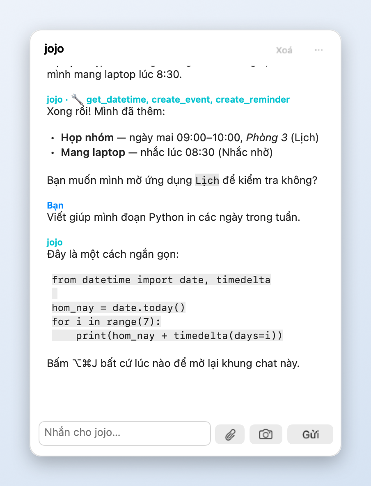
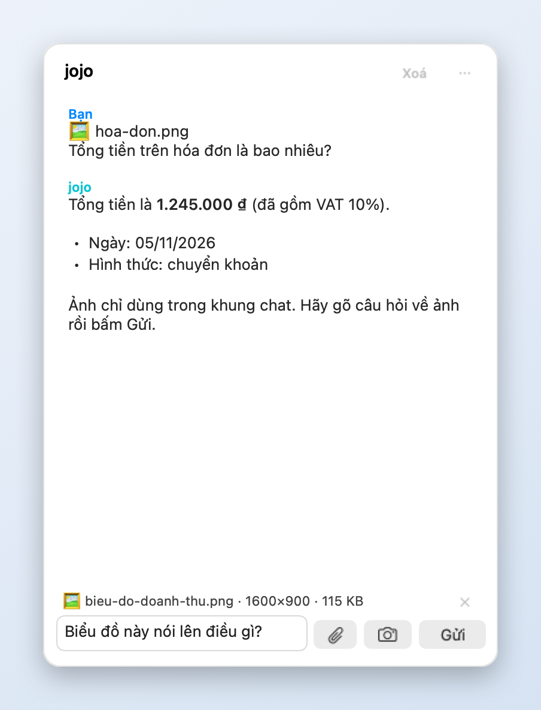
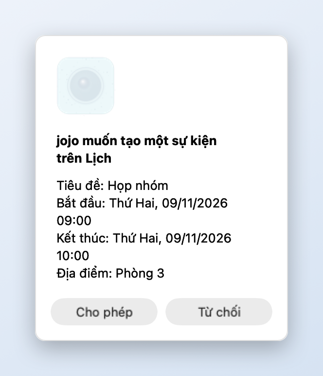
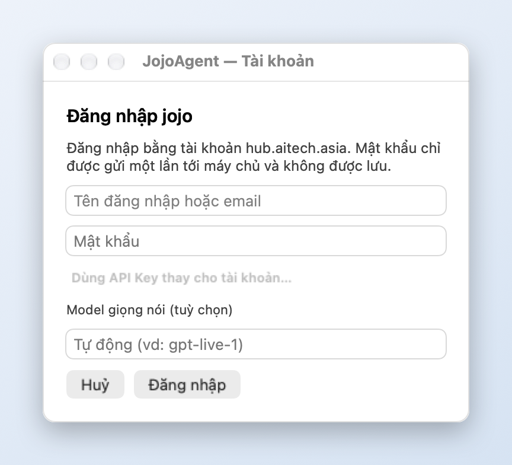

# Jojo — Your Personal AI Agent from AitechAsia

**JojoAgent (`JojoAgent.app`)** là trợ lý AI cá nhân bằng giọng nói trực tiếp trên macOS từ **AitechAsia**, giúp bạn trò chuyện rảnh tay và hỗ trợ giải đáp trực tiếp ngay trên màn hình làm việc.

---

## 🖼️ Hình minh hoạ

> Các ảnh dưới đây được dựng từ giao diện thật của ứng dụng; nội dung hội thoại, tên tệp và số liệu chỉ là **ví dụ minh hoạ**.

**Chat trên Menu Bar:** trả lời chạy dần, hiển thị Markdown (danh sách, khối mã, liên kết), và nhãn 🔧 cho các công cụ jojo đã dùng. Bấm trái ◉ hoặc nhấn `⌥⌘J` để mở.

**Đính kèm ảnh / tệp và chụp màn hình:** nút 📎 chọn tệp văn bản, PDF hoặc ảnh; nút camera chụp màn hình rồi hỏi jojo.

**Luôn hỏi trước khi làm việc có tác động:** thêm lịch, nhắc việc, mở ứng dụng, đọc / ghi tệp đều hiện hộp *Cho phép / Từ chối* với nội dung thật (nút mặc định là *Từ chối*).

**Đăng nhập:** mật khẩu chỉ gửi một lần, token lưu trong Keychain của macOS.

---

## 📦 Cài đặt trên macOS

**Yêu cầu hệ thống:** macOS 12.0 trở lên (hỗ trợ cả chip Apple Silicon `M1/M2/M3/M4` và Intel).

### Cách 1: Cài đặt bằng bộ cài `.dmg` (Khuyên dùng)
1. Tải tệp **`JojoAgent-macos-universal-v1.4.0.dmg`** từ trang [**Releases**](https://github.com/ethando1984/JojoAgent/releases/latest) (hoặc tải trực tiếp tệp **`JojoAgent.dmg`** trong repository này).
2. Nhấp đúp mở tệp `.dmg`, sau đó kéo biểu tượng **`JojoAgent.app`** thả vào thư mục **`Applications`**.
3. Mở **`JojoAgent`** từ **Applications** hoặc **Launchpad**. Nếu macOS hỏi xác nhận mở ứng dụng lần đầu, chọn **Open** (hoặc chạy lệnh `xattr -cr /Applications/JojoAgent.app` trong Terminal).

### Cách 2: Tải tệp `.zip` hoặc `.app` trực tiếp
1. Tải **`JojoAgent-macos-universal-v1.4.0.zip`** từ trang [**Releases**](https://github.com/ethando1984/JojoAgent/releases/latest) và giải nén (hoặc lấy trực tiếp thư mục **`JojoAgent.app`**).
2. Kéo **`JojoAgent.app`** vào thư mục **`/Applications`** và mở ứng dụng.

---

## 🚀 Hướng dẫn sử dụng

### 0. Chat văn bản trên Menu Bar
**Bấm trái** vào biểu tượng **◉** (hoặc nhấn **`⌥⌘J`** từ bất kỳ ứng dụng nào) để mở khung chat với jojo. **Bấm phải** ◉ (hoặc nút **⋯**) mở menu 3 dòng: *Bắt đầu / Kết thúc cuộc gọi*, *Tài khoản…*, *Thoát jojo*.

- **Trả lời chạy dần + Markdown:** chữ hiện ngay khi máy chủ gửi; hỗ trợ **đậm**, *nghiêng*, `mã`, khối mã, tiêu đề, danh sách, trích dẫn và liên kết (chỉ `http(s)` / `mailto`, luôn hiện địa chỉ thật khi rê chuột).
- **📎 Đính kèm:** tệp văn bản / PDF (≤ 2 MB, đọc 20.000 ký tự đầu) hoặc **ảnh** (≤ 15 MB, tự thu nhỏ; ảnh quá lớn so với gói dịch vụ sẽ tự thử lại bản gọn). Tệp cũng được gửi cho cuộc gọi giọng nói (gửi ngay nếu đang gọi, hoặc khi cuộc gọi bắt đầu); ảnh chỉ dùng trong chat.
- **Camera:** chụp màn hình và hỏi jojo (dùng câu bạn gõ trong ô nhập, nếu có). Lần đầu macOS hỏi quyền Screen Recording.
- **Lịch sử chat được giữ giữa các lần mở app** (40 tin gần nhất, lưu cục bộ, không lưu nội dung tệp / ảnh đính kèm). Nút **Xoá** hoặc **Đăng xuất** xoá lịch sử; tắt hẳn bằng `defaults write asia.aitech.jojo.agent jojo_save_history -bool false`.

**Jojo có thể gọi công cụ** khi bạn nhờ (khung chat hiện *“Đang dùng công cụ: …”* và nhãn 🔧):
- *Tự chạy (chỉ đọc):* chụp & phân tích màn hình, xem ngày giờ, đọc clipboard, xem ứng dụng đang dùng, xem thông tin máy.
- *Luôn hỏi bạn trước (Cho phép / Từ chối):* mở trang web, mở ứng dụng, đọc tệp văn bản (chỉ trong Desktop / Documents / Downloads), tạo hoặc ghi đè tệp (chỉ trong `~/Documents/JojoAgent`), thêm sự kiện Lịch, thêm nhắc việc, xem lịch 7 ngày tới, xem nhắc việc chưa hoàn thành.
- **Trong cuộc gọi giọng nói** jojo cũng dùng được lịch, nhắc việc, mở ứng dụng / trang web và xem ngày giờ, vẫn qua đúng hộp Cho phép / Từ chối (bạn bấm chuột để đồng ý). Với model gpt-live, tính năng này cần máy chủ gateway đã cập nhật.

### 1. Đăng nhập / Cấu hình lần đầu
1. Khi mở ứng dụng, biểu tượng **◉** của **JojoAgent** sẽ xuất hiện trên thanh Menu Bar (góc trên bên phải màn hình) cùng quả cầu **Jojo** ở góc dưới màn hình.
2. Nhấp vào biểu tượng **◉** trên Menu Bar → **bấm phải** (hoặc nhấn phím tắt **`⌘,`**) → chọn **Tài khoản…**.
3. Nhập **Tài khoản & Mật khẩu** của bạn trên **AitechAsia** (hoặc nhập **Token / API Key**), sau đó nhấn **Lưu**.

### 2. Trò chuyện bằng giọng nói
- **Bắt đầu / Kết thúc cuộc gọi:** Nhấp trực tiếp vào quả cầu **Jojo** trên màn hình hoặc nhấn **`⌘R`**.
- Lần đầu sử dụng, macOS sẽ hỏi quyền truy cập **Microphone** — hãy nhấn **Allow (Cho phép)** để trò chuyện với Jojo.
- Khi đang trò chuyện, cửa sổ mặc định ở chế độ **Thu gọn** kèm phụ đề hội thoại nổi giúp bạn vừa nói chuyện vừa làm việc. Bạn có thể cuộn lên/xuống trên khung hội thoại để xem lại lịch sử trò chuyện.

### 3. Di chuyển & Chuyển đổi chế độ hiển thị
- **Di chuyển vị trí:** Nhấn giữ chuột vào quả cầu **Jojo** và kéo tới bất kỳ vị trí nào trên màn hình (hỗ trợ cả ở chế độ thu nhỏ và toàn màn hình).
- **Mở rộng / Thu gọn:** Nhấn nút **Mở rộng / Thu gọn** bên dưới quả cầu.

### 4. Nhờ Jojo xem & giải thích nội dung trên màn hình
- **Bằng giọng nói:** Trong lúc đang trò chuyện, bạn chỉ cần nói tự nhiên như:
  - *"Jojo chụp màn hình xem giúp mình lỗi này là gì"*
  - *"Trên màn hình đang hiển thị gì vậy?"*
  - *"Giải thích nội dung trên màn hình giúp tôi"*
- **Bằng nút bấm:** Nhấn biểu tượng **📸** cạnh quả cầu (hoặc nút **📸 Chụp màn hình** ở chế độ toàn màn hình).
- *Lưu ý:* Lần đầu chụp, macOS sẽ hỏi quyền **Screen Recording**; JojoAgent tự mở **System Settings → Privacy & Security → Screen & System Audio Recording**. Bật **JojoAgent** rồi **thoát và mở lại ứng dụng** để quyền có hiệu lực. Nếu đã bật mà vẫn không chụp được, chạy `tccutil reset ScreenCapture asia.aitech.jojo.agent` rồi cấp lại.

---

## ⌨️ Phím tắt nhanh

| Phím tắt | Chức năng |
| :--- | :--- |
| **`⌥⌘J`** | Mở / đóng khung chat (từ bất kỳ ứng dụng nào) |
| **`⌘R`** | Bắt đầu / Kết thúc cuộc gọi giọng nói |
| **`⌘,`** | Mở cửa sổ Tài khoản |
| **`⌘Q`** | Thoát ứng dụng JojoAgent |

---

## 🔒 Bảo mật & hiệu năng (v1.4.0)
- Token / API Key được lưu trong **macOS Keychain**, không còn lưu dạng văn bản thường và không bao giờ được đưa vào trang web của ứng dụng. Đăng nhập bằng tài khoản được xử lý hoàn toàn bên trong ứng dụng.
- Ứng dụng chỉ gọi tới máy chủ AitechAsia đã cấu hình (HTTPS); token và mật khẩu được che trong nhật ký nội bộ.
- **Tài khoản… → Đăng xuất** xoá token khỏi Keychain.
- Chụp màn hình dùng ScreenCaptureKit (macOS 14+), ứng dụng nhẹ hơn và tiêu tốn ít CPU hơn khi rảnh.
