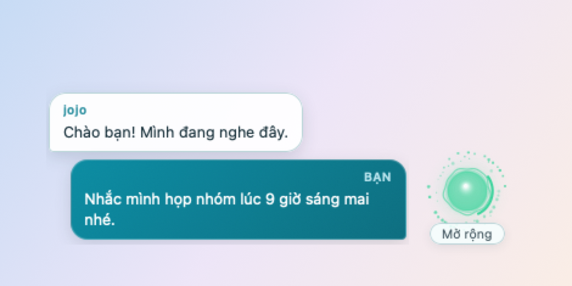
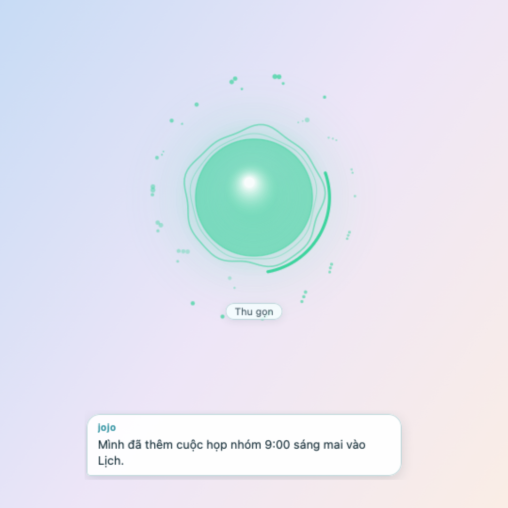

# Jojo — Your Personal AI Agent from AitechAsia

**JojoAgent** is a personal AI assistant from **AitechAsia** that lives on your desktop. Talk to it hands-free in a live voice call, chat with it in text, and let it look at your screen to help with what you are working on.

| Platform | Status | Download |
| :--- | :--- | :--- |
| **macOS** 12+ (Apple Silicon and Intel) | Stable, `v1.4.2` | [Latest release](https://github.com/ethando1984/JojoAgent/releases/latest) |
| **Windows** 10 / 11 (64-bit) | **Preview** | [Windows preview release](https://github.com/ethando1984/JojoAgent/releases/tag/v1.4.2-windows-preview) |

---

## 🖼️ Screenshots

> The images below are rendered from the real macOS app; the conversation text, file names and figures are **examples only**. The app's own interface is in Vietnamese.

**Chat from the menu bar:** replies stream in as they are written, with Markdown (lists, code blocks, links) and a 🔧 label for the tools jojo used. Left-click ◉ or press `⌥⌘J` to open it.

**Attach an image or file, or capture the screen:** the 📎 button picks a text file, a PDF or an image; the camera button captures the screen and asks jojo about it.

**Voice call, compact mode:** a small **jojo** orb in the corner of the screen with live subtitles; drag it to move it, click **Mở rộng** (Expand) to enlarge.

**Voice call, full mode:** a large audio-reactive orb that follows the voice in real time (its colour changes with listening / thinking / speaking); click **Thu gọn** (Collapse) to go back.

**Always asks before doing anything with an effect:** adding a calendar event or a reminder, opening an app, reading or writing a file all show an *Allow / Deny* dialog with the real details (the default button is *Deny*).

**Sign-in and invites:** the password is sent once, and the token is kept in the macOS Keychain (on Windows, encrypted with DPAPI). No account yet? The sign-in window has a **"Chưa có tài khoản? Xin lời mời →"** link to the invite page on the Hub: enter your email, and an administrator reviews the request, creates your account and sends you the sign-in details.

---

## 📦 Install on macOS

**Requirements:** macOS 12.0 or later (Apple Silicon `M1/M2/M3/M4` and Intel).

### Option 1: the `.dmg` installer (recommended)
1. Download **`JojoAgent-macos-universal-v1.4.2.dmg`** from [**Releases**](https://github.com/ethando1984/JojoAgent/releases/latest) (or take **`JojoAgent.dmg`** straight from this repository).
2. Double-click the `.dmg`, then drag **`JojoAgent.app`** onto the **`Applications`** folder.
3. Open **`JojoAgent`** from **Applications** or **Launchpad**. If macOS asks you to confirm the first launch, choose **Open** (or run `xattr -cr /Applications/JojoAgent.app` in Terminal).

### Option 2: the `.zip` or the `.app` directly
1. Download **`JojoAgent-macos-universal-v1.4.2.zip`** from [**Releases**](https://github.com/ethando1984/JojoAgent/releases/latest) and unzip it (or take the **`JojoAgent.app`** folder from this repository).
2. Drag **`JojoAgent.app`** into **`/Applications`** and open it.

---

## 🪟 Install on Windows (preview)

> **This is a preview.** The Windows version is new and has had no testing on real PCs yet, so expect rough edges. It is not code-signed. Please report what you find in [Issues](https://github.com/ethando1984/JojoAgent/issues).

**Requirements:** Windows 10 (version 2004 or later) or Windows 11, 64-bit (x64). A microphone for voice calls.

### Option 1: the installer (recommended)
1. Download **`JojoAgent-windows-x64-v1.4.2-preview-Setup.exe`** from the [**Windows preview release**](https://github.com/ethando1984/JojoAgent/releases/tag/v1.4.2-windows-preview).
2. Run it. Because the preview is not code-signed, Windows SmartScreen shows a warning: choose **More info → Run anyway**.
3. Follow the installer. It installs for your Windows account only (no administrator prompt), adds a Start menu shortcut, and installs Microsoft Edge WebView2 Runtime if your PC does not have it.
4. JojoAgent starts with an icon in the system tray (near the clock) and the **jojo** orb at the bottom-right of the screen.

To remove it: **Settings → Apps → Installed apps → JojoAgent → Uninstall**.

### Option 2: portable `.zip`
Download **`JojoAgent-windows-x64-v1.4.2-preview.zip`**, unzip it anywhere and run **`JojoAgent.exe`**. This needs Microsoft Edge WebView2 Runtime, which Windows 11 and most Windows 10 PCs already have.

### What is different on Windows
- **Tray icon instead of the menu bar:** left-click the tray icon to open the chat, right-click it for the menu. The global shortcut is **`Ctrl+Alt+J`**.
- **Sign-in storage:** the token is encrypted with Windows DPAPI for your Windows account (`%APPDATA%\JojoAgent`), and is never given to the app's web page.
- **Calendar and reminders** use classic Outlook when it is installed. Without it, creating an event or reminder opens an `.ics` file in your calendar app for you to save, and listing events or reminders is not available.
- **Mouse and keyboard control** needs no extra permission, but cannot act on windows that run as administrator.
- **Image attachments:** PNG, JPEG, GIF, BMP and TIFF (HEIC is not supported).
- If something goes wrong, errors are written to `%LOCALAPPDATA%\JojoAgent\jojo.log`.

---

## 🚀 How to use it

The steps below describe the macOS app. On Windows the same features are reached from the tray icon, with the shortcut differences listed above.

### 0. Text chat from the menu bar
**Left-click** the **◉** icon (or press **`⌥⌘J`** from any app) to open the chat with jojo. **Right-click** ◉ (or the **⋯** button) for the three-row menu: *Start / End call*, *Account…*, *Quit jojo*.

- **Streaming replies + Markdown:** text appears as soon as the server sends it; **bold**, *italic*, `code`, code blocks, headings, lists, quotes and links are supported (links only to `http(s)` / `mailto`, and the real address always shows on hover).
- **📎 Attach:** a text file / PDF (≤ 2 MB, the first 20,000 characters are read) or an **image** (≤ 15 MB, downscaled automatically; an image too large for your plan is retried once in a compact version). A file is also handed to the voice call (immediately if a call is live, otherwise when one starts); images are used in chat only.
- **Camera:** captures the screen and asks jojo about it (using what you typed in the input box, if anything). The first time, macOS asks for the Screen Recording permission.
- **Chat history is kept between launches** (the last 40 messages, stored locally, without the contents of attached files or images). **Xoá** (Clear) or signing out deletes it; turn it off entirely with `defaults write asia.aitech.jojo.agent jojo_save_history -bool false`.

**Jojo can call tools** when you ask (the chat shows *“Đang dùng công cụ: …”* (Using tool: …) and a 🔧 label):
- *Runs by itself (read-only):* capture and analyse the screen, get the date and time, read the clipboard, see which app you were using, get system information.
- *Always asks you first (Allow / Deny):* open a web page, open an app, read a text file (only in Desktop / Documents / Downloads), create or overwrite a file (only in `~/Documents/JojoAgent`), add a calendar event, add a reminder, list the next 7 days of your calendar, list unfinished reminders.
- *Mouse and keyboard control (one Allow opens a 5-minute session):* `click_on_screen`, `type_text`, `press_key`, `scroll_screen`. jojo looks at a fresh screenshot to find what to click, never types into password fields, and is limited to 30 actions per minute. **Press `Esc` at any time to stop.** On macOS this needs JojoAgent enabled under **System Settings › Privacy & Security › Accessibility**; on Windows it cannot act on windows that run as administrator.
- **During a voice call** jojo can also use the calendar, reminders, open apps / web pages and get the date and time, through the same Allow / Deny dialog (you approve with a click). With the gpt-live model this needs an up-to-date gateway server.

### 1. Sign in / first-time setup
1. When the app opens, the **JojoAgent** **◉** icon appears in the menu bar (top right of the screen) and the **jojo** orb at the bottom of the screen.
2. **Right-click** the **◉** icon (or press **`⌘,`**) and choose **Tài khoản…** (Account…).
3. Enter your **AitechAsia** **username and password** (or a **token / API key**), then confirm.
4. No account yet? Click **Chưa có tài khoản? Xin lời mời →** in the same window. It opens the Hub's invite page; enter your email and wait for an administrator to approve it. You then receive your username, password and API token (by email when the Hub has email set up).

### 2. Talk by voice
- **Start / end a call:** click the **jojo** orb on the screen, or press **`⌘R`**.
- The first time, macOS asks for access to the **Microphone** — choose **Allow** to talk to jojo.
- During a call the window stays in **compact** mode with floating subtitles, so you can talk and keep working. Scroll the subtitles up and down to review the conversation.

### 3. Move the orb and switch display mode
- **Move:** press and hold on the **jojo** orb and drag it anywhere on the screen (in both compact and full mode).
- **Expand / collapse:** click the **Mở rộng / Thu gọn** button under the orb.

### 4. Ask jojo to look at and explain what is on the screen
- **By voice:** during a call, just say it naturally, for example:
  - *"Jojo, take a screenshot and tell me what this error is"*
  - *"What is on my screen right now?"*
  - *"Explain what is on the screen for me"*
- **By button:** click the **📸** icon next to the orb (or the **📸 Chụp màn hình** (Capture screen) button in full mode).
- *Note:* the first capture makes macOS ask for the **Screen Recording** permission; JojoAgent opens **System Settings → Privacy & Security → Screen & System Audio Recording** for you. Turn on **JojoAgent**, then **quit and reopen the app** for the permission to take effect. If it is on and capture still fails, run `tccutil reset ScreenCapture asia.aitech.jojo.agent` and grant it again.

---

## ⌨️ Keyboard shortcuts

| macOS | Windows (preview) | Action |
| :--- | :--- | :--- |
| **`⌥⌘J`** | **`Ctrl+Alt+J`** | Open / close the chat (from any app) |
| **`⌘R`** | Tray menu | Start / end the voice call |
| **`⌘,`** | Tray menu | Open the Account window |
| **`⌘Q`** | Tray menu | Quit JojoAgent |

---

## 🔒 Security and performance (v1.4.2)
- The token / API key is stored in the **macOS Keychain** (on Windows: encrypted with DPAPI), never as plain text, and is never handed to the app's web page. Signing in with an account is handled entirely inside the app.
- The app only calls the configured AitechAsia server (HTTPS); tokens and passwords are masked in the internal log.
- **Account… → Sign out** removes the token from the Keychain.
- Screen capture uses ScreenCaptureKit (macOS 14+); the app is lighter and uses less CPU when idle.
